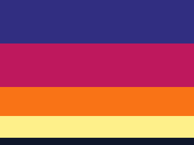

# ColorSnap – Image to Color Palette Extractor

> A modern, client-side web application inspired by Linear, Figma, and Coolors that instantly extracts the 5 dominant colors from any image.



---

## 1. Project Overview

**ColorSnap** allows designers, developers, and creators to drop in or upload an image (JPG, PNG with transparency, WebP) and instantly extract its **five dominant colors** directly in the browser. 

- **100% Client-Side Processing**: No image data is ever uploaded to external servers, cloud AI, or third-party APIs. Your images remain private and secure on your local device.
- **Accurate Mathematical Clustering**: Employs a custom K-Means++ clustering engine with redmean perceptual distance weighting, transparency rejection, diversity enforcement, and relative frequency calculations.
- **Production-Grade UI/UX**: Designed with modern design tokens, seamless light and dark modes, responsive layouts, instant one-click clipboard copying, and versatile export formats (JSON, CSS variables, and high-res PNG cards).

---

## 2. Key Features

- **Drag-and-Drop Image Uploader**:
  - Interactive drop zone with visual drag-over feedback.
  - Supports JPG, JPEG, PNG (including transparent PNGs), and WebP formats up to 15 MB.
  - Built-in one-click sample images (Sunset Glow, Forest Meadow, Deep Ocean) for instant testing.
  - Full keyboard accessibility and comprehensive validation.

- **Image Preview & Metadata**:
  - Displays original filename, image dimensions (width × height px), file size (KB/MB), and format tags without image distortion.
  - "Change Image" and "Re-extract Palette" controls.

- **5 Dominant Color Swatches**:
  - Large, interactive tactile color preview cards.
  - Click any swatch card or HEX code to copy the HEX value (`#RRGGBB`).
  - Click any RGB row to copy the exact RGB values (`rgb(r, g, b)`).
  - Displays relative pixel dominance percentage (e.g., `38.2%`) calculated across non-transparent sampled pixels.
  - Displays curated design color names (e.g., *Emerald*, *Midnight Blue*, *Tangerine*, *Sage Green*).
  - Automated WCAG contrast calculation ensuring labels and copy indicators remain legible on any shade.

- **Export & Action Suite**:
  - **Copy All HEX Codes**: Copies all 5 HEX values separated by line breaks.
  - **Copy All RGB Codes**: Copies all 5 RGB values separated by line breaks.
  - **Download Palette (.json)**: Downloads a structured JSON payload containing extraction metadata, color names, HEX, RGB, HSL, and dominance percentages.
  - **Download as CSS**: Generates clean, ready-to-use `:root` CSS custom properties (`--color-1` to `--color-5`) along with utility classes.
  - **Download Card (.png)**: Generates a 1200×630px high-resolution social/design palette card suitable for Figma, Notion, or presentations.
  - **Extract Another Image**: Instant reset to analyze additional images without refreshing the page.

- **Palette History**:
  - Automatically saves the last 5 extracted palettes into browser `localStorage`.
  - Only stores lightweight color signatures and filenames (zero heavy image data).
  - One-click palette reopening and history clearing.

- **Theme & Responsiveness**:
  - Light & dark modes with persistent user preference storage.
  - Mobile, tablet, and widescreen desktop responsive grid layouts.

---

## 3. Technology Stack

- **Markup & Presentation**: HTML5, CSS3 with modern CSS custom properties and flexible CSS Grid/Flexbox.
- **Typography**: Google Fonts (*Inter* for clean UI and *JetBrains Mono* for hex values).
- **Icons**: Inline SVG vector icons (Lucide-inspired).
- **Core Engine**: Vanilla JavaScript (ES6+), zero external runtime dependencies.
- **Local Web Server**: Native Node.js HTTP server (`server.js`) with MIME handling, security headers, and automatic port conflict resolution.

---

## 4. Project Folder Structure

```text
color-extract/
├── index.html                   # Semantic HTML5 single-page application
├── css/
│   └── style.css                # Design tokens, light/dark themes, responsive layout
├── js/
│   ├── color-extractor.js       # K-Means++ clustering, distance metric & palette engine
│   ├── utils.js                 # Clipboard fallback, toasts, downloads, theme & history
│   └── app.js                   # UI event wiring, drag-and-drop, state orchestration
├── assets/
│   └── samples/                 # Sample images for testing & instant demos
│       ├── nature-meadow.png
│       ├── transparent-badge.png
│       └── sunset-horizon.png
├── scripts/
│   └── generate-samples.js      # Procedural sample image generator
├── tests/
│   ├── test-extractor.js        # Algorithm unit tests
│   ├── test-integration.js      # Headless PNG decoding and extraction tests
│   └── test-server.js           # Server routing and security tests
├── server.js                    # Zero-dependency local Node.js development server
├── package.json                 # Project configuration & npm test scripts
├── start.bat                    # One-click Windows startup script
└── README.md                    # Project documentation
```

---

## 5. Prerequisites

- **Windows 10 / 11** (or macOS / Linux).
- **Node.js** (v16+ recommended for the local dev server). If Node.js is not present, `index.html` can also be opened directly in any modern web browser.

---

## 6. How to Run the Application

### Option A: Using `start.bat` (Recommended on Windows)

Double-click `start.bat` in the project folder, or run from PowerShell / Command Prompt:

```cmd
.\start.bat
```

**What `start.bat` does:**
1. Verifies that the Node.js runtime is installed.
2. Automatically opens your default web browser to `http://localhost:3000`.
3. Starts the local zero-dependency development server.
4. Keeps the terminal open with clear instructions and logs.

---

### Option B: Running Manually via Command Line

1. Open your terminal in the project directory:
   ```bash
   cd c:\Cs-Projects\color-extract
   ```

2. Start the local server:
   ```bash
   node server.js
   # or
   npm start
   ```

3. Open `http://localhost:3000` in any web browser.

---

## 7. How the Color Extraction Algorithm Works

The extraction engine in [`js/color-extractor.js`](js/color-extractor.js) follows a structured 5-stage pipeline:

```
[Uploaded Image]
       │
       ▼
[Offscreen Canvas Sampling] ──> Resizes image proportionally (max 200px edge)
       │
       ▼
[Pixel Filtering] ─────────────> Rejects transparent pixels (alpha < 125)
       │
       ▼
[K-Means++ Initialization] ────> Probabilistically seeds 5 initial centroids spread across RGB space
       │
       ▼
[K-Means Clustering Loop] ─────> Assigns pixels via Redmean perceptual distance; iterates until convergence
       │
       ▼
[Diversity & Tonal Guard] ─────> Merges near-duplicate clusters (dist < 32); provides harmonic tonal fills
       │
       ▼
[Rich Palette Output] ─────────> Calculates exact percentages, WCAG text contrast, and color names
```

### Key Mathematical Components:
1. **Perceptual Redmean Distance**:
   Instead of simple Euclidean distance in RGB space, ColorSnap applies the human-eye weighted redmean formula:
   $$\bar{r} = \frac{r_1 + r_2}{2}$$
   $$\Delta C = \sqrt{\left(2 + \frac{\bar{r}}{256}\right)\Delta r^2 + 4\Delta g^2 + \left(2 + \frac{255 - \bar{r}}{256}\right)\Delta b^2}$$
2. **K-Means++ Seeding**:
   Chooses the first centroid uniformly at random, then chooses subsequent centroids with probability proportional to the squared distance $D(x)^2$ from the nearest existing centroid. This prevents clustering exclusively around background colors.
3. **Diversity Enforcement**:
   If an image contains rich contrast, any two clusters closer than perceptual distance $\Delta C < 32$ are merged and a new cluster is created from the furthest outlier pixels. If the image has fewer than 5 distinct colors (such as a 2-color logo), harmonic tonal variants are gracefully synthesized so that 5 cohesive, non-identical swatches are always delivered.

---

## 8. Exporting and Downloading Palettes

- **Download Palette (.json)**:
  Produces a JSON file containing:
  ```json
  {
    "generator": "ColorSnap - Image to Color Palette Extractor",
    "sourceImage": "nature-meadow.png",
    "extractedAt": "2026-10-14T08:44:23.000Z",
    "colorCount": 5,
    "palette": [
      {
        "index": 1,
        "name": "Sky Blue",
        "hex": "#63CAFA",
        "rgb": "rgb(99, 202, 250)",
        "hsl": "hsl(199, 93%, 68%)",
        "percentage": 20.7,
        "percentageString": "20.7%"
      }
    ]
  }
  ```

- **Download as CSS**:
  Produces clean CSS variables ready to drop into stylesheets:
  ```css
  :root {
    --color-1: #63CAFA; /* 20.7% - Sky Blue | rgb(99, 202, 250) */
    --color-2: #80A60C; /* 20.0% - Lime Green | rgb(128, 166, 12) */
    --color-3: #1E293B; /* 20.0% - Charcoal | rgb(30, 41, 59) */
    --color-4: #15803D; /* 20.0% - Forest Green | rgb(21, 128, 61) */
    --color-5: #B7E5FD; /* 19.3% - Off White | rgb(183, 229, 253) */
  }
  ```

- **Download Card (.png)**:
  Renders a 1200×630px social card on an HTML5 canvas and downloads it directly to your machine.

---

## 9. Running Automated Tests

To run the complete automated test suite (unit tests, integration tests, and server HTTP checks):

```bash
npm test
```

Or run individual test modules:
```bash
# Unit test for color conversions and K-Means logic
node tests/test-extractor.js

# Integration test with actual decoded PNG image files
node tests/test-integration.js

# Server test for HTTP routing, MIME types, and security
node tests/test-server.js
```

---

## 10. Common Errors & Troubleshooting

| Issue | Cause | Solution |
| :--- | :--- | :--- |
| **"Unsupported file format"** | The uploaded file is not a supported image type. | Ensure your file is a `.jpg`, `.jpeg`, `.png`, or `.webp` image. |
| **"File is too large"** | The file exceeds 15 MB. | Compress the image or use a standard resolution photo under 15 MB. |
| **Port 3000 in use** | Another local service is using port 3000. | `server.js` automatically tries port 3001, 3002, etc. Check the terminal for the active URL or set `PORT=4000 node server.js`. |
| **Clipboard blocked** | Browser security restriction in unverified contexts. | ColorSnap automatically detects clipboard restrictions and opens a selectable text modal so you can copy with `Ctrl+C`. |
| **All transparent pixels** | Image has 100% alpha transparency. | Upload an image with visible graphic elements. |

---

## 11. Privacy & Security

ColorSnap does not include analytics, telemetry, or external tracking. **All image processing occurs strictly on your device using native browser APIs.**
